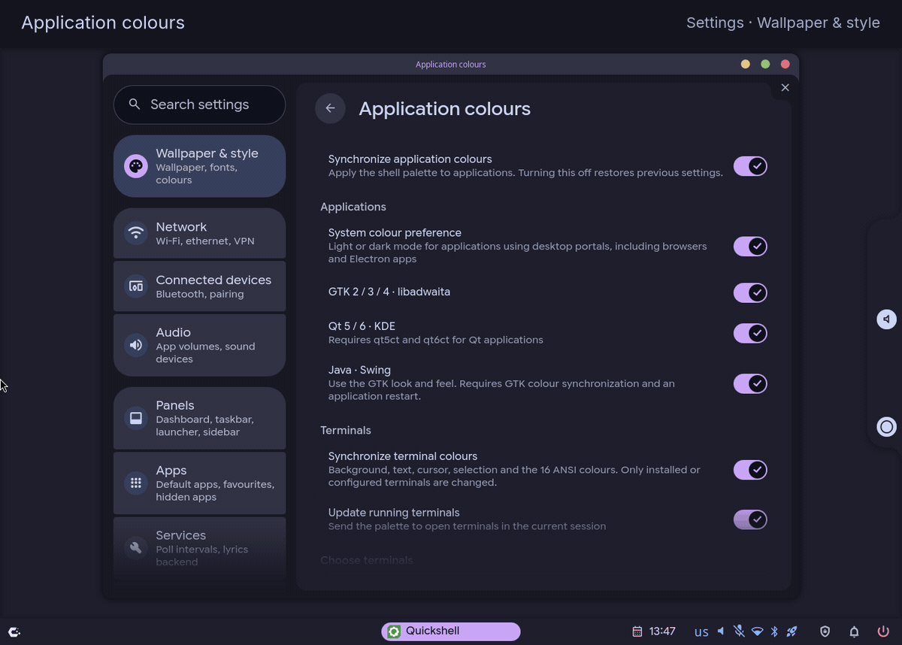
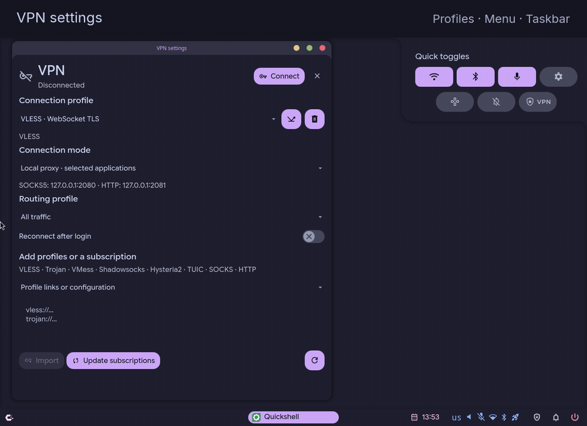

[Русский](README.md)

  

<h1 align="center">Hyprstack</h1>

Two ways to work with windows. One desktop shell for Hyprland.

  <a href="INSTALL.en.md">Installation</a> ·
  <a href="MAINTENANCE.md#обновление">Updating (Russian)</a> ·
  <a href="CONFIGURATION.md">Configuration (RU)</a> ·
  <a href="#demo">Demo</a>

Hyprstack is a Hyprland shell with scrolling tiling and floating windows.
Switch modes with a single shortcut; each mode remembers your window layout.
Russian is the default language; English and the system language are available
in settings.

## See it in action

<table>
  <tr>
    <td align="center" width="50%"> Dashboard · calendar, media and widgets</td>
    <td align="center" width="50%"> Taskbar · notifications and quick actions</td>
  </tr>
  <tr>
    <td align="center"> Settings · transparency, shadows and scale</td>
    <td align="center"> Overview · every window in sight</td>
  </tr>
  <tr>
    <td align="center"> Application colours · GTK, Qt, Java and terminals</td>
    <td align="center"> VPN · menu and taskbar</td>
  </tr>
  <tr>
    <td align="center"> Touchpad gestures</td>
  </tr>
</table>

## Features

- **Scrolling and stacking.** A strip of columns and floating windows with
  titlebars, minimise and maximise controls. In tiling, focus follows the pointer.
- **Overview.** Window and workspace thumbnails. Stacking includes an Alt+Tab
  switcher with window previews.
- **Taskbar.** Application groups, pinned apps, window previews, workspaces and
  a system tray, with configurable items and placement.
- **Search and launch.** Applications, calculator, clipboard history, themes
  and wallpapers.
- **Notifications.** History, grouping, actions and Do Not Disturb.
- **System controls.** Audio, networking, Bluetooth, screenshots and recording.
- **VPN.** VLESS/XHTTP/Reality, Trojan, VMess, Shadowsocks, Hysteria2 and TUIC
  using sing-box/Xray, profile and subscription imports, TUN and local proxies.
  Connect from quick actions or the taskbar; open VPN settings under Network.
- **Dashboard.** Calendar, media controls, system status and weather.
- **Appearance.** 18 built-in colour themes, light and dark modes, accents,
  colour synchronization for GTK, Qt, Java Swing and popular terminals,
  interface scaling, gaps, corners, transparency and animations.
- **Lock and authentication.** PAM screen lock and a built-in Polkit agent.

## Installation

- [Arch Linux / CachyOS / EndeavourOS / Manjaro](INSTALL.en.md#arch) — packages,
  build and configuration.
- [NixOS](INSTALL.nixos.en.md) — package and NixOS/Home Manager modules.

Requires **Hyprland 0.57.0**, **Quickshell ≥ 0.3.1**, **Qt ≥ 6.9**.
Rebuild the native module when upgrading from 0.56 and log in again.
Settings include window wobble, 11 blur variants, inner glow and motion blur.
Rebuild the native extension after a Hyprland ABI change.

[Updates and recovery (Russian)](MAINTENANCE.md#обновление).

Keep custom settings in `~/.config/hyprstack/`: override default keybindings in
`hypr-vars.lua`, add bindings and other settings in `local.lua`, and configure
displays in `monitors.lua`. These files and interface preferences survive
`./update.sh`. Updates overwrite the standard files in `~/.config/hypr/` and the managed
`hyprstack/hypr-user.lua`; the current colour scheme is preserved.
See [configuration (Russian)](CONFIGURATION.md).

## Getting started

| Shortcut | Action |
| --- | --- |
| `Super+Ctrl+Shift+M` | Switch scrolling / stacking |
| `Super` | Open the dashboard |
| `Super+D` | Application launcher |
| `Super+O` | Window and workspace overview |
| `Super+Return` | Terminal selected during setup |
| `Super+W` | Browser selected during setup |
| `Super+E` | System file manager · home folder |
| `Ctrl+Alt+V` | Audio settings · pavucontrol |
| `Super+H` / `Super+L` | Adjacent window in scrolling |
| `Super+J` / `Super+K` | Adjacent workspace |
| `Super+Alt+Space` | Toggle a floating window |
| `Alt+Tab` | Window switcher in stacking |
| `Super+Q` | Close the window |
| `Ctrl+Super+L` | Lock the session |

The full shortcut list with search is in **Сочетания клавиш** (Keybindings).
To switch to English, open **Язык и регион → Язык интерфейса** and select English.

In scrolling mode, swipe horizontally with three fingers to scroll columns and
vertically to switch workspaces. Swipe up with four fingers to open overview;
swipe down to activate the selection and close it.
[Gesture settings (Russian)](CONFIGURATION.md#жесты-тачпада).

## Documentation

- [Configuration, shortcuts, themes and weather (Russian)](CONFIGURATION.md)
- [Updates, diagnostics and manual removal (Russian)](MAINTENANCE.md)
- [Third-party components and licences](THIRD_PARTY.md)

## Credits and licence

The interface builds on [Caelestia shell](https://github.com/caelestia-dots/shell).
The project uses [Quickshell](https://quickshell.org/),
[Hyprland](https://hypr.land/), a modified hyprbars and
[M3Shapes](https://github.com/soramanew/m3shapes).

Licence: [GPL-3.0](LICENSE). Component and font licences are listed
in [THIRD_PARTY.md](THIRD_PARTY.md).
